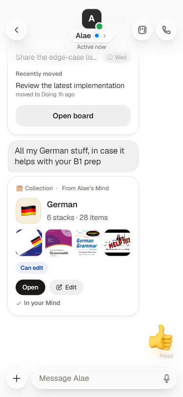
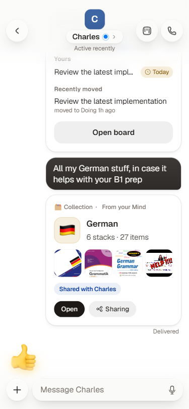
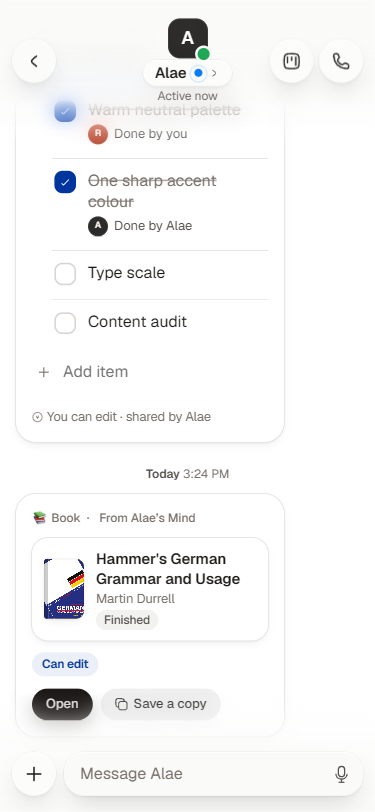
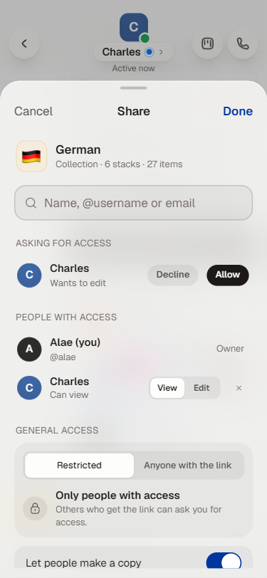
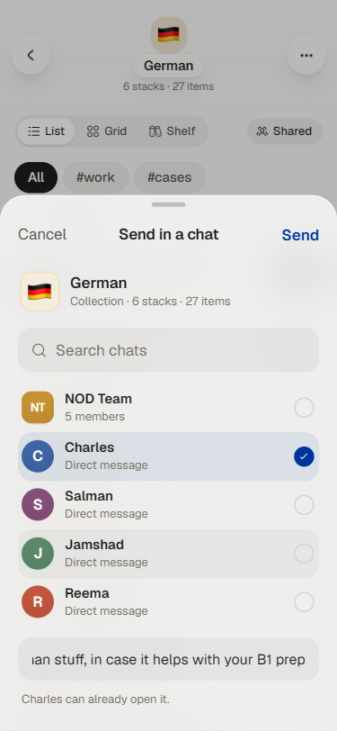
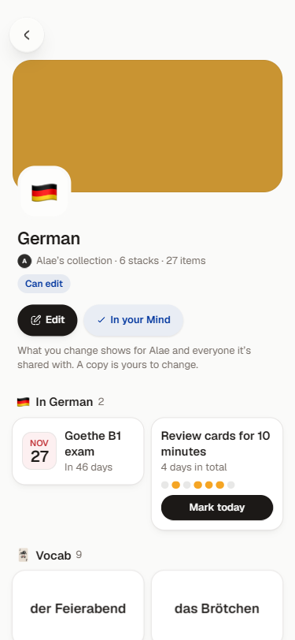
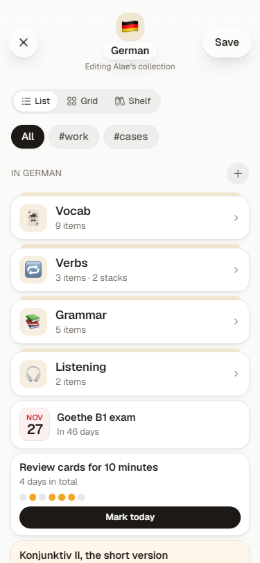
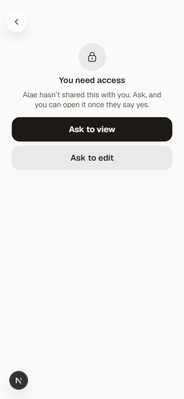

# Sharing from Mind

Share a whole collection, or one item in it, with the people you talk to. Access works like Google Drive: specific people who can **view** or **edit**, or **anyone with the link**. People can also **make their own copy** and change it freely. A share is sent into a chat as a live card.

## How it looks in a message

| Charles (it was shared with him) | Alae (she shared it) | One item, shared on its own |
| --- | --- | --- |
|  |  |  |

The card is a **pointer**, not a snapshot. It reads the owner's Mind live, so items added, a book moved to "Finished", or access granted or removed all show on the card straight away.

- **Collection card:** icon and name, how many items, four previews (covers, photos and video stills first), and what you can do.
- **Item card:** the item itself, laid out like it is in Mind.
- **Your access:** "Can view", "Can edit", or for the owner who it's shared with ("Shared with Charles").
- **Buttons:**

  | Who | Buttons |
  | --- | --- |
  | Owner | Open · Sharing |
  | Can edit | Open · Edit · Make a copy |
  | Can view | Open · Make a copy |

  For a single item, Make a copy is called **Save a copy**. Copy buttons only show when the owner allows copies. Once you've copied a collection, the card says **In your Mind**.
- **No access:** the card shows the name and "Alae hasn't given you access", with **Request access**. After you ask, it says **Request sent**, with **Withdraw**.
- **Gone:** if the owner deletes it, the card keeps its name and says "No longer in Alae's Mind".

## Sharing something

Where to start:
- **A collection:** the **Share** button next to the List / Grid / Shelf switch; hold the collection and choose **Share…**; or Collection settings → **Sharing**.
- **An item:** hold it and choose **Share…**, or open it and tap **Share** next to Move.

Saves from chats can't be shared on their own: they point at messages other people may not be part of. Shared collections get a small people badge on their folder.

### The share sheet



- **Add people** by name, @username, phone number or email. Choose **Can view** or **Can edit** before adding.
  - Someone on NOD gets access straight away.
  - An email address that isn't on NOD yet is listed as "Invited · not on NOD yet". They get that role once they join.
- **People with access:**
  - you, as Owner
  - everyone you added, each with a View / Edit switch and a remove button
- **Asking for access:** requests appear at the top, with **Decline** and **Allow**. Allow gives the role that was asked for.
- **General access:**
  - **Restricted:** only people listed can open it. Anyone else who gets the link can ask.
  - **Anyone with the link**, who can view or edit. That includes everyone in any chat it was sent to.
- **Let people make a copy:** on by default.
- **Copy link** and **Send in a chat.**

### Sending it into a chat



1. Pick one of your chats, most recent first. DMs and groups are both listed, and the list can be searched.
2. Optionally add a message. It's sent as a normal message just before the card.
3. If anyone in that chat can't open it yet, the sheet says so ("Give Charles access", "Give 3 people in NOD Team access") and lets you choose View or Edit. Sending grants that role to exactly those people; nobody else's access changes. This is like Drive asking "give access?" when you share a link with someone who has none.

## What people it's shared with can do

| | Owner | Can edit | Can view | No access |
| --- | :-: | :-: | :-: | :-: |
| See it in the chat and open it | ✓ | ✓ | ✓ | name only |
| Change it | ✓ | ✓ | | |
| Make or save a copy (if allowed) | | ✓ | ✓ | |
| Ask for access or for edit access | | | ✓ | ✓ |
| Change who has access | ✓ | | | |

You get the **best** of everything that grants you access:
- being added by name
- the link setting
- for an item, the whole collection it's in being shared

So if a collection is shared with you, you can open every item in it.

### Opening a shared collection



It opens as a read-only page laid out like a collection on Explore:
- the cover, name and owner, with how many items
- your access, and for viewers an **Ask Alae to edit** link
- the action buttons
- everything in the collection in one grid, with a Filter (tags, when it changed, type) like your own collections

Tapping an item opens its sheet:
- **Viewers** see it in detail. Videos play, and **Save a copy to my Mind** lets them pick one of their collections, or a "📥 Shared with you" collection that's created the first time.
- **Editors** get the same controls as on their own items: shelf, status, date, the palette maker and so on. Changes save straight to the owner's item.

### Editing a collection



**Edit** opens the full Mind editor (the one group Minds use), titled "Editing Alae's collection". It works on a copy of the collection:
- Everything works as in your own Mind: add, move, nest, delete, change views.
- **Save** puts the changes into the owner's collection.
- **Cancel** with changes asks before discarding them.

On Save, the things only the owner controls stay as the owner left them: who it's shared with, whether it's on Explore, and which chats feed it.

### Making a copy

**Make a copy** copies the collection into your Mind:
- every item, with its tags, and the collection's layout
- every item

The copy is yours to change, and nothing flows back to the original. Two things stay behind:
- the owner's **To sort** pile
- saves from chats (they point at messages you may not be in)

### Opening a link



A share link (`nod.app/m/<token>`; in the prototype, `?mind=<owner>~<collection>[~<item>]`) opens:
- the collection's page or the item's sheet, if you have access
- otherwise **You need access**, with **Ask to view** and **Ask to edit**

Once the owner allows the request, the screen turns into the page right away.

## Privacy rules

- A collection's **To sort** pile (its inbox of saves from chats) is never shared, viewed, edited or copied.
- A **save from a chat** only shows its message to people in that chat. Everyone else sees "Saved from a chat you're not in".
- Only the **owner** changes who has access. Editors change the content, not the sharing.
- Copies carry no sharing settings: a copy starts private.

## How it's built

**Data**
- `Sharing` sits on a collection, or on one item shared by itself (`src/lib/chat/mind.ts`):
  ```ts
  { link: "off" | "view" | "edit";
    people: Record<userId, "view" | "edit">;
    emails: Record<email, "view" | "edit">;
    copy: boolean;
    requests: { userId; role; at }[] }
  ```
- A new card type is only a pointer (`src/lib/chat/types.ts`):
  ```ts
  { type: "mind"; owner; collectionId; blockId?; title; emoji }
  ```
  The title and emoji are kept for when the original is gone.
- Copies remember where they came from: `from: { id: "share:<token>", by: owner }`.

**Code**
- `src/lib/chat/share.ts`: access rules (`accessOf`), granting, requests, links and tokens, copying a collection or an item.
- `src/lib/chat/mind.ts`: the editable copy of a shared collection (`startShareDraft`, `commitShareDraft`, `projectCollection`).
- `src/components/chat/Share.tsx`: the share sheet, the send sheet, the card, the shared page, the shared item sheet, and the link handler.
- `src/components/chat/Mind.tsx`: the Share buttons, the shared badge, and the full-screen editor (it now also edits shared collections).
- `src/components/chat/ChatApp.tsx`: opens `?mind=` links.

## Limits in the prototype (what a real backend needs)

- **Everything is local.** Sharing reads and writes the owner's Mind in this browser's storage, which every signed-in identity shares. A server would store shares and check `accessOf` on every read and write.
- **Links are guessable** (owner and collection ids). Real links need random tokens that can be revoked.
- **No notifications.** Nothing tells the owner about a request or tells someone they've been given access. The card and the share sheet just update when they're opened.
- **Email invites go nowhere.** Nobody on NOD has an email address yet, so invites wait in the list.
- **The last save wins.** If two people edit the same collection, whoever saves last replaces the other's edits. A real version would merge changes as boards and plans already do (`src/lib/chat/ops.ts`).
- **Editors can't reshare**, and there's no comment-only role.
- There's no expiry date, no transfer of ownership, and no version history.

## Next steps worth considering

- Notify the owner of access requests, with Allow and Decline right in the notification.
- A "Shared with you" place in Mind listing everything others have shared with you.
- Show who else is in a shared collection, and who changed what and when.
- A comment role, plus an expiry date for link access.
- Let editors share further when the owner allows it.
